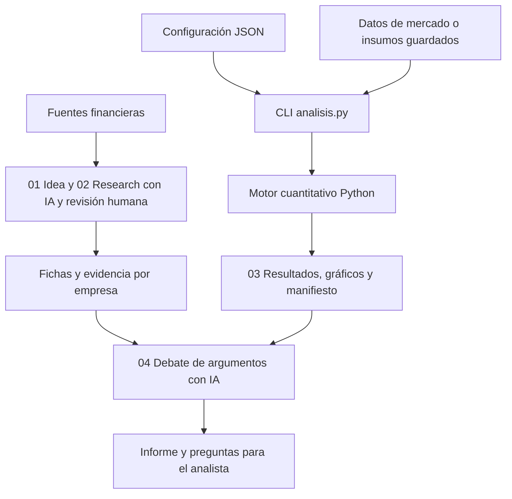

# Agente Financiero | Python e IA aplicada al análisis de inversiones

Herramienta de investigación de empresas que combina un motor cuantitativo en Python con un flujo de trabajo asistido por IA. Organiza fuentes, calcula métricas de riesgo y conserva los datos y supuestos necesarios para revisar cómo se llegó a cada resultado.

Proyecto personal de **José Domingo Urrutia**, desarrollado con asistencia de IA para integrar investigación financiera, análisis de riesgo y trazabilidad en una herramienta reutilizable por empresa. El trabajo incluye ejecución parametrizable, validación de datos, pruebas y documentación técnica. Es un prototipo funcional, con un caso histórico de Apple disponible para revisión.

**Revisar en pocos minutos:** [caso Apple](empresas/AAPL/Inicio.md) · [ejecutor Python](analisis.py) · [pruebas](tests/test_analisis.py) · [informe cuantitativo PDF](empresas/AAPL/03_cuantitativo/2026-10-23_AAPL_lectura_03.pdf)

## El problema que aborda

Una investigación financiera puede terminar repartida entre notebooks, búsquedas, planillas e informes. Eso dificulta saber qué fuente respalda una conclusión, con qué parámetros se calculó un indicador y cómo repetirlo después.

Este proyecto reúne la investigación por empresa y conecta tres piezas: **evidencia fechada, cálculo reproducible y contraste de argumentos**. Está orientado a apoyar el trabajo del analista. No se ha medido un ahorro de tiempo ni un impacto comercial.

## Qué funciona hoy

| Capacidad | Implementación |
| --- | --- |
| Análisis de retornos y riesgo | Comparación de una acción con un benchmark: retorno, volatilidad, Sharpe, Sortino y drawdown. |
| Modelación de escenarios | Volatilidad GJR-GARCH con innovaciones t, simulación Monte Carlo, VaR/CVaR, beta y escenarios condicionales. |
| Integración de datos de mercado | Precios ajustados y captura de volatilidad implícita mediante `yfinance`; validación de precios, cobertura y moneda. |
| Ejecución por empresa | CLI con configuración JSON y parámetros por argumento, sin copiar las fórmulas para cada ticker. |
| Trazabilidad | Cada corrida guarda precios, opciones, configuración, resultados, versiones y huellas SHA-256 en una carpeta nueva. |
| Research asistido por IA | Cuatro skills con instrucciones, fichas de traspaso y fuentes; el debate contrasta perspectivas alcista, bajista y neutral. |
| Reporting | Resumen Markdown, ficha, resultados JSON y gráficos generados por Python; informes de lectura revisados por etapa. |

La investigación y el debate se realizan desde Codex con revisión de fuentes y supervisión humana. **La CLI automatiza el bloque cuantitativo.** El repositorio no implementa llamadas directas a APIs de LLMs ni un pipeline automático de extracción de documentos financieros.

## Desarrollo y decisiones técnicas

El trabajo de desarrollo se concentra en convertir el flujo de análisis en una herramienta reutilizable, conservar la evidencia de cada ejecución y agregar controles para revisar los resultados.

| Trabajo realizado en el proyecto | Evidencia para revisarlo |
| --- | --- |
| Separación entre motor, ejecución y parámetros por empresa | [`src/modelo_curso.py`](src/modelo_curso.py), [`analisis.py`](analisis.py) y [`config/ejemplo.json`](config/ejemplo.json). |
| Creación de expedientes sin sobrescribir configuración ni notas existentes | Función `create()` y pruebas de conservación y separación de empresas en [`tests/test_analisis.py`](tests/test_analisis.py). |
| Conservación de insumos para repetir cálculos sin descargar datos nuevos | Opción `--repetir`, captura de opciones y [manifiesto de Apple](empresas/AAPL/03_cuantitativo/2026-10-23_230246_610362_SPY_REAL/manifest.json). |
| Controles antes de aceptar resultados | Rechazo de precios inválidos, monedas incompatibles, historia insuficiente y ajustes GARCH sin convergencia o sin nivel estacionario de largo plazo. |
| Correcciones estadísticas puntuales | Drawdown que incluye el capital inicial, exclusión de crisis incompletas y cálculo de Kupiec con cero excepciones, con pruebas asociadas. |
| Adaptación del flujo de IA a archivos persistentes | [Skills](.agents/skills/), fichas por etapa y [paquete de evidencia del debate](empresas/AAPL/04_debate/2026-10-24_AAPL_paquete_evidencia.md). |

El desarrollo se realizó con asistencia de IA. La revisión del código, los controles y las limitaciones documentadas forman parte del trabajo presentado.

**Referencias metodológicas:** material del Club de Finanzas e Inversiones, conservado en [`material_curso/`](material_curso/). La [revisión técnica](docs/revision.md) distingue la base de referencia de las adaptaciones y correcciones implementadas.

## Cómo se conectan las piezas



Las fichas conectan las etapas. Cada etapa se ejecuta cuando se solicita; crear una empresa no inicia una investigación. La decisión de inversión corresponde al usuario.

**Tecnologías:** Python 3.12, NumPy, pandas, SciPy, `arch`, statsmodels, Matplotlib, `yfinance`, `unittest`, Jupyter, Git y skills de Codex. El almacenamiento actual usa archivos CSV, JSON y Markdown.

## Caso demostrable: Apple frente a SPY

El [expediente AAPL](empresas/AAPL/Inicio.md) reúne idea, research, análisis cuantitativo y debate. La evidencia financiera tiene corte al **23 de octubre de 2026** y el debate fue elaborado el **24 de octubre de 2026**. Son resultados históricos; editar este README no actualiza sus datos.

Para revisar el proyecto desde la pregunta financiera hasta el cálculo:

1. Leer el [research del negocio](empresas/AAPL/02_research/2026-10-23_AAPL_research.md) y sus faltantes declarados.
2. Abrir el [resumen de la corrida REAL frente a SPY](empresas/AAPL/03_cuantitativo/2026-10-23_230246_610362_SPY_REAL/resumen.md) y su [manifiesto](empresas/AAPL/03_cuantitativo/2026-10-23_230246_610362_SPY_REAL/manifest.json).
3. Revisar el [control de la repetición numérica histórica](empresas/AAPL/03_cuantitativo/2026-10-23_AAPL_verificacion_03.json), que documenta coincidencia exacta de los resultados en aquella repetición.
4. Seguir el [debate](empresas/AAPL/04_debate/2026-10-24_AAPL_debate.md) hasta sus conclusiones y preguntas pendientes.

No se atribuye rentabilidad de inversión al uso de la herramienta. La decisión personal sigue pendiente.

## Ejecutar una demostración

Desde la raíz del repositorio, en macOS y con Python 3.12 instalado:

```bash
python3.12 -m venv .venv
.venv/bin/python -m pip install -r requirements.txt
.venv/bin/python -m unittest discover -s tests -v
.venv/bin/python analisis.py ejecutar --empresa AAPL --demo
```

En VS Code, seleccionar `.venv/bin/python` como intérprete; para usar el notebook, seleccionar también ese entorno como kernel. El notebook está en [`notebooks/`](notebooks/).

La instalación requiere internet. Una vez instaladas las dependencias, **DEMO no descarga datos bursátiles**: usa precios sintéticos y crea una carpeta nueva dentro de `empresas/AAPL/03_cuantitativo/`, con resumen, ficha, precios, resultados, seis gráficos y manifiesto. Sus cifras solo sirven para comprobar funcionamiento.

**Validación del 4.nov.2026:** siete pruebas aprobadas y DEMO completa sobre una copia de la versión publicada, usando Python 3.12.14 en macOS ARM64. Las pruebas cubren casos estadísticos y protección de expedientes; no constituyen una auditoría completa del modelo. Las versiones principales están fijadas en [`requirements-modelo.txt`](requirements-modelo.txt).

### Repetir el caso histórico sin consultar datos nuevos

```bash
.venv/bin/python analisis.py ejecutar --repetir "empresas/AAPL/03_cuantitativo/2026-10-23_230246_610362_SPY_REAL"
```

Se reutilizan los precios, las opciones y la configuración guardados. Se comprueban sus huellas y se genera otra carpeta. El motor y las versiones pueden afectar la igualdad numérica: el programa informa diferencias respecto del manifiesto original.

### Crear otra empresa o descargar datos actuales

```bash
.venv/bin/python analisis.py crear --ticker MSFT --benchmark SPY
.venv/bin/python analisis.py ejecutar --empresa MSFT
```

El primer comando prepara el expediente y conserva archivos existentes. El segundo consulta Yahoo Finance y requiere conexión e historia suficiente. Los tickers son ejemplos de uso. Revisar `config.json`, moneda, comparador y supuestos antes de una corrida REAL; un error o falta de datos no se reemplaza por resultados DEMO.

## Estructura del repositorio

```text
analisis.py                 CLI, validación, captura y repetición
src/modelo_curso.py         motor cuantitativo compartido
config/ejemplo.json         parámetros iniciales para nuevas empresas
tests/                     pruebas con unittest
.agents/skills/             procedimientos de las cuatro etapas
empresas/TICKER/            configuración, fuentes, informes y bitácora
  01_idea/                 selección y ficha inicial
  02_research/             negocio, competencia y fuentes
  03_cuantitativo/          una carpeta por corrida
  04_debate/               evidencia y contraste de argumentos
notebooks/                 acceso al mismo motor desde Jupyter
material_curso/             originales de referencia
docs/                      revisión, validación y guías
```

Las corridas DEMO, los entornos y los PNG cuantitativos regenerables se excluyen de Git. Los datos y controles de corridas reales se conservan. Los PDF de lectura permiten revisar resultados sin ejecutar Python.

## Alcance y próximos pasos

- **Modelo financiero:** estudia retornos y riesgo. No calcula valor intrínseco ni precios objetivo. La tasa inicial de 4% anual es un supuesto del modelo sin validación como tasa vigente; las simulaciones dependen de sus supuestos.
- **Validación:** el test de VaR está dentro de muestra. R² mide asociación con el comparador, no causalidad. No se ha acreditado capacidad predictiva fuera de muestra.
- **IA:** los roles del debate comparten evidencia y modelo; no representan verificaciones externas independientes. Las fuentes y las conclusiones requieren revisión humana.
- **Estado de ingeniería:** herramienta local por terminal. No incorpora SQL/PostgreSQL, backend FastAPI, frontend React, Docker, CI/CD ni despliegue cloud.
- **Dominio:** el caso implementado es de acciones cotizadas. No cubre gestión de portafolios de activos alternativos, capital calls, distribuciones ni conciliación de flujos.

Como evolución del proyecto, los pasos propuestos son automatizar las pruebas en CI, estructurar y validar un tipo acotado de reporte financiero mediante una API de LLM y persistir esa información en SQL. Son trabajo futuro, sin implementación en esta versión.

Para profundizar: [revisión del modelo](docs/revision.md), [validación inicial](docs/validacion.md), [recorrido técnico](docs/recorrido.md), [glosario](Glosario.md) y [portada de trabajo](Inicio.md).
